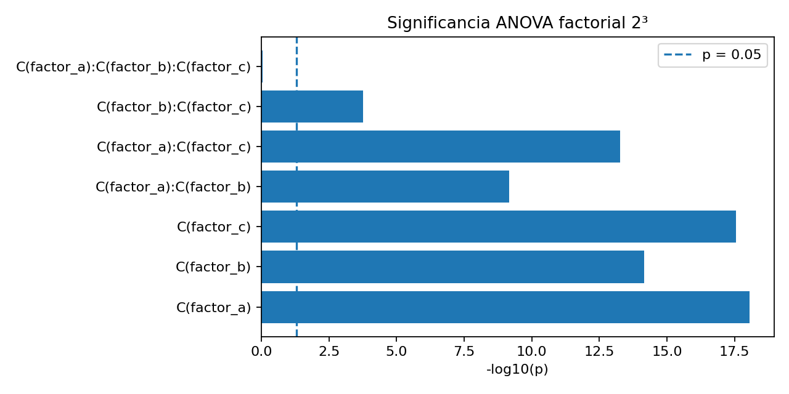
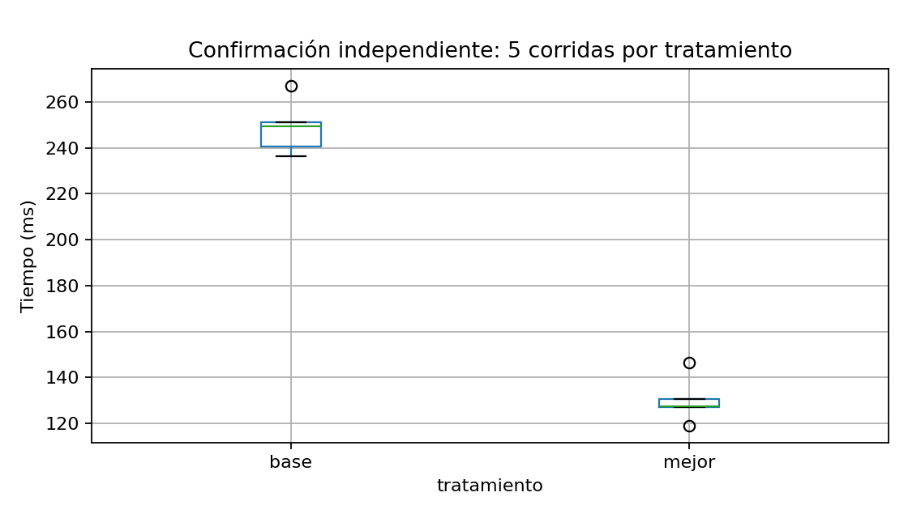

# E2 — Informe de Análisis Estadístico

**Proyecto:** TRUSTED DATA LAB — Observatorio inmobiliario de Colima
**Fecha de ejecución:** 22 de noviembre de 2026, 22:30:24 UTC
**Fuente local:** `data/bronce/sniiv_registro/registro_20261122T202044Z.json`, 2,140 registros
**Software registrado:** Python 3.13.15, pandas 2.3.3
**Respuesta:** tiempo de ejecución en milisegundos para 30 ciclos de agregación de registros SNIIV. Menor es mejor.

## 1. Objetivo e hipótesis

Determinar cómo afectan distintas decisiones de procesamiento al tiempo de agregación de registros SNIIV. Para cada efecto principal e interacción, la hipótesis nula del ANOVA es que su efecto es cero, con α = 0.05. El resultado mide rendimiento informático, **no precios, demanda ni oferta de vivienda**.

## 2. Protocolo y trazabilidad

Los diseños utilizaron tres réplicas por tratamiento y un orden aleatorizado (semilla 20261122). Se utilizaron datos locales, sin llamar a fuentes externas. La implementación reporta que todos los tratamientos produjeron la misma agregación que la referencia. Se conservaron las 90 mediciones originales en `corridas_aleatorizadas.csv` y los resultados estadísticos en `RESULTADOS_ESTADISTICA_E2.zip`.

**Precaución:** los experimentos comparten computadora y captura; no se bloquearon variaciones de carga del sistema, hora o caché. La aleatorización reduce sesgos sistemáticos pero no elimina esos efectos.

## 3. Factorial 2³ — 24 corridas

Factores: A tamaño de lote (128 frente a 512), B conversión a categoría (no/sí), C ordenación previa (no/sí). Ocho tratamientos, tres réplicas cada uno. El modelo ANOVA incluye los tres efectos principales, tres interacciones de dos factores y la interacción triple.

| Término | F | p | Interpretación a α=0.05 |
|---|---:|---:|---|
| C(factor_a) | 2347.74 | 8.68e-19 | Significativo |
| C(factor_b) | 750.57 | 7.14e-15 | Significativo |
| C(factor_c) | 2022.70 | 2.84e-18 | Significativo |
| C(factor_a):C(factor_b) | 167.88 | 6.72e-10 | Significativo |
| C(factor_a):C(factor_c) | 580.66 | 5.31e-14 | Significativo |
| C(factor_b):C(factor_c) | 23.64 | 0.000173 | Significativo |
| C(factor_a):C(factor_b):C(factor_c) | 0.02 | 0.88 | No significativo |

La interacción triple no fue significativa (p=0.8804); las interacciones dobles sí lo fueron. Por ello, los efectos principales deben interpretarse junto con las interacciones. El tratamiento con menor media observada fue A=+ (512), B=− (sin categoría), C=− (sin ordenación), según `medias_tratamientos_2_3.csv`.

## 4. Diseño de dos factores 3×2 — 18 corridas

Factor A: tamaños de lote 64, 256 y 1024; factor B: conversión a categoría no/sí. Se observó evidencia estadística de efecto de A (p=6.86×10⁻¹⁵), B (p=2.91×10⁻¹⁴) y su interacción (p=9.27×10⁻¹³). **Limitación:** Shapiro-Wilk sobre los residuos dio p=0.0423; por tanto se rechaza normalidad a α=0.05 y las inferencias paramétricas requieren cautela. Levene p=0.907 no mostró evidencia de heterogeneidad de varianzas.

## 5. Factorial 2⁴ completo frente a fracción 2^(4−1)

El factorial completo empleó 16 tratamientos × 3 réplicas = 48 corridas. Se agregó D: ordenación interna de `groupby` (no/sí). A, B y C tuvieron efectos principales significativos; D no (p=0.8056). Se detectaron interacciones significativas, entre ellas AB, AC y BC. Consultar `anova_2_4.csv` para los resultados completos.

La fracción regular utiliza **D=ABC**, con relación definitoria **I=ABCD** y resolución IV. Alias: A=BCD; B=ACD; C=ABD; D=ABC; AB=CD; AC=BD; AD=BC. Por ello no permite identificar por separado interacciones de dos factores confundidas. Las 24 observaciones de la fracción se **seleccionaron de las 48 del factorial completo**: no constituyen 24 corridas adicionales independientes. El ANOVA fraccionado disponible ajusta solamente efectos principales, por lo que puede absorber interacciones omitidas en el error. Su Shapiro-Wilk p=0.0214 cuestiona normalidad y limita la inferencia. En el modelo ajustado A, B y C fueron significativos y D no.

## 6. Corridas de confirmación — 10 mediciones

Se ejecutaron cinco mediciones de la configuración base y cinco del tratamiento seleccionado. Sus medias fueron **248.947 ms** y **130.136 ms**, respectivamente, una reducción de **47.73%** calculada como (base−seleccionada)/base × 100. La confirmación es independiente de las corridas de selección en el sentido de que son mediciones adicionales, pero se realizó en el mismo entorno y no garantiza una mejora generalizable.

## 7. Conclusiones y límites de validez

En esta ejecución local, evitar ordenación previa y conversión a categoría con lote de 512 dio la mejor media entre los tratamientos del factorial 2³. El experimento de confirmación mostró una reducción media del tiempo de 47.73% frente a la configuración base. La presencia de interacciones y las violaciones de normalidad detectadas obligan a interpretar con cautela algunas pruebas ANOVA; no deben presentarse como prueba de causalidad generalizable a otras máquinas o capturas. La fracción 2^(4−1) ahorra tratamientos pero confunde interacciones de segundo orden. Para fortalecer la validez externa se recomienda repetir en varias sesiones y computadoras, bloquear por sesión y estudiar los residuos gráficamente.

## 8. Evidencias

- `corridas_aleatorizadas.csv`: mediciones individuales y orden de ejecución.
- `anova_2_3.csv`: ANOVA principal del diseño 2³.
- `confirmacion.csv`: diez corridas de confirmación.
- `graficas/`: visualizaciones reproducidas desde CSV originales.
- **Archivo fuente que debe conservarse:** `RESULTADOS_ESTADISTICA_E2.zip`, con los 14 archivos originales, incluyendo todos los ANOVA, diagnósticos y fracción.

**Nota de transparencia:** este informe fue elaborado con asistencia de IA a partir de los resultados entregados; no sustituye los archivos originales ni una auditoría de la implementación experimental.
